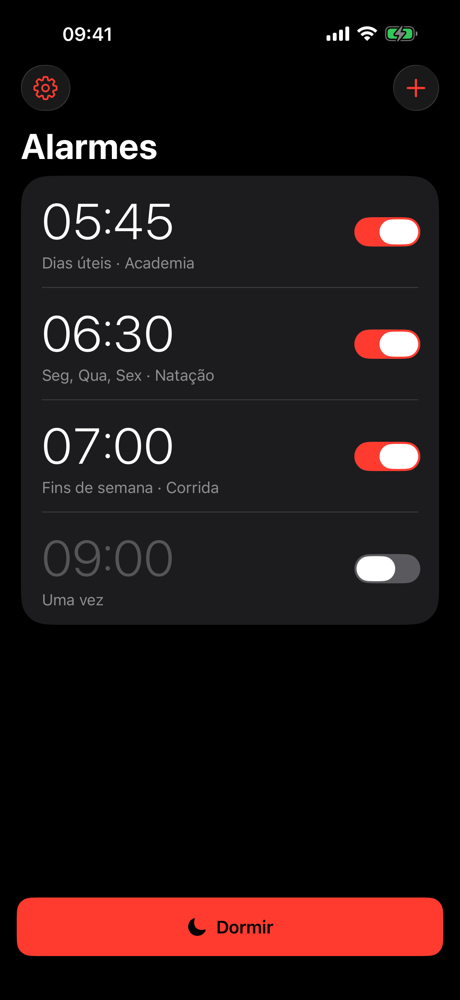
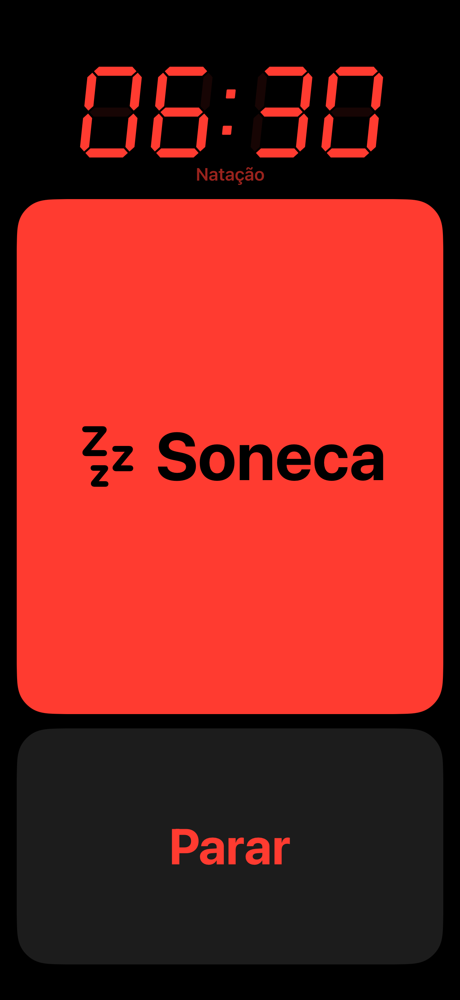
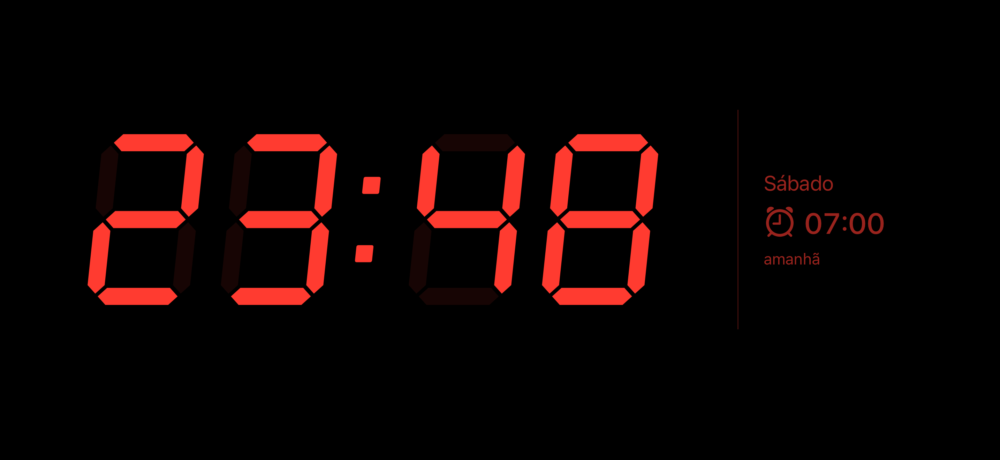

# Mais 5 Minutinhos

Despertador de cabeceira para iPhone: à noite, um relógio grande e escuro no carregador; de manhã, o alarme toca pelo AlarmKit, mesmo no silencioso, com dois botões gigantes: Soneca e Parar.

## Prints

<p>
  
  
  
</p>

## Principais funcionalidades

- Criar, editar, ativar/desativar e excluir alarmes (até 10), com repetição por dia da semana ou toque único.
- Soneca configurável por alarme, com contagem regressiva em Live Activity na tela bloqueada e na Dynamic Island.
- Alarmes pelo AlarmKit: tocam com o app fechado, no silencioso e com Foco ativo.
- Modo cabeceira: relógio em tela cheia, paisagem, escuro, com brilho reduzido e tela sem apagar; entra sozinho quando o iPhone fica deitado no carregador.
- Tela de alarme dentro do app com botões gigantes de Soneca e Parar.
- 4 temas de relógio × 5 cores, formato 24h/12h e segundos opcionais.
- 7 sons próprios, sintetizados por código, além do som padrão do iPhone.
- Compra única (sem assinatura) que libera temas, cores e sons extras.
- Sem conta, sem backend, sem analytics: nenhum dado sai do aparelho.

## Stack técnica

- Swift 6 + SwiftUI, iOS 26+ (iPhone)
- AlarmKit (alarmes) e ActivityKit/WidgetKit (Live Activity da soneca)
- SwiftData (persistência local)
- StoreKit 2 (compra não consumível)
- Core Motion (detecção do aparelho deitado para o modo cabeceira)
- XcodeGen (`project.yml` versionado; o `.xcodeproj` é gerado)
- Swift Testing + StoreKitTest

## Como foi construído

Desenvolvido com Claude (Anthropic) a partir de uma especificação SDD: [`SDD-mais-5-minutinhos.md`](SDD-mais-5-minutinhos.md), com o modelo de dados em [`modelo-mais-5-minutinhos.dbml`](modelo-mais-5-minutinhos.dbml).

- Convenções para o agente de código: [`CLAUDE.md`](CLAUDE.md).
- Prompts usados no design e na implementação: [`prompt-design-mais-5-minutinhos.md`](prompt-design-mais-5-minutinhos.md) e [`prompt-implementacao-mais-5-minutinhos.md`](prompt-implementacao-mais-5-minutinhos.md).
- Referência de design em HTML (protótipo das telas, recriado depois em SwiftUI): [`cabeceira-design-system/`](cabeceira-design-system/).
- Testes unitários (Swift Testing) em [`Tests/`](Tests/): persistência, regras de alarme, entrada automática no modo cabeceira, catálogo de sons, direitos de compra e compra via StoreKitTest.
- Validação em aparelho físico documentada em [`docs/validacao.md`](docs/validacao.md) e [`docs/spike-alarmkit.md`](docs/spike-alarmkit.md) (AlarmKit não roda de verdade no simulador).
- Documentação técnica: [`DOCUMENTACAO-TECNICA.md`](DOCUMENTACAO-TECNICA.md).

## Status

Em desenvolvimento: o build 1.0.0 foi enviado à revisão da App Store e ainda não consta como publicado.

## Licença

O código está disponível apenas para leitura e estudo. Veja [LICENSE](LICENSE).

## Contribuições

Issues são bem-vindas; pull requests não são aceitos. Veja [CONTRIBUTING.md](CONTRIBUTING.md).

## Como rodar

Requisitos: Xcode 26.1+ e [XcodeGen](https://github.com/yonaskolb/XcodeGen) (`brew install xcodegen`).

```bash
xcodegen generate
open MaisCincoMinutinhos.xcodeproj
```

Os alarmes (AlarmKit) só funcionam de verdade em iPhone físico. O simulador serve para layout e testes unitários.

Sem variáveis de ambiente, segredos ou backend.

### Compra no simulador

O scheme usa [`MaisCincoMinutinhos.storekit`](MaisCincoMinutinhos.storekit) ao rodar pelo Xcode. Os testes da compra usam o mesmo arquivo pelo StoreKitTest.

### Sons e ícone

Os 7 sons são sintetizados por [`scripts/make-sounds.py`](scripts/make-sounds.py) (licenças em [`Resources/Sounds/LICENSES.md`](Resources/Sounds/LICENSES.md)). O ícone é gerado por [`scripts/make-app-icon.swift`](scripts/make-app-icon.swift).

### Testes

```bash
xcodebuild test -project MaisCincoMinutinhos.xcodeproj -scheme MaisCincoMinutinhos -destination 'platform=iOS Simulator,name=iPhone 17 Pro'
```

Para ver as telas sem tocar alarme (só em Debug): `xcrun simctl launch booted com.dablab.mais5minutinhos -debugRinging YES` (alarme tocando) ou `-debugSnooze YES` (cabeceira em soneca).

---

Feito pela [Dab Lab](https://www.dablab.com.br/) — product studio de software e IA que constrói apps para pequenas empresas, startups e áreas dentro de grandes empresas, partindo de uma especificação (Spec-Driven Development) e com as disciplinas de engenharia de software robusta.
